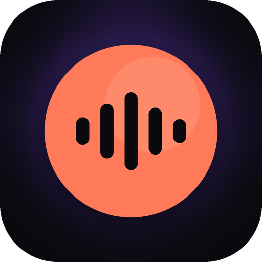
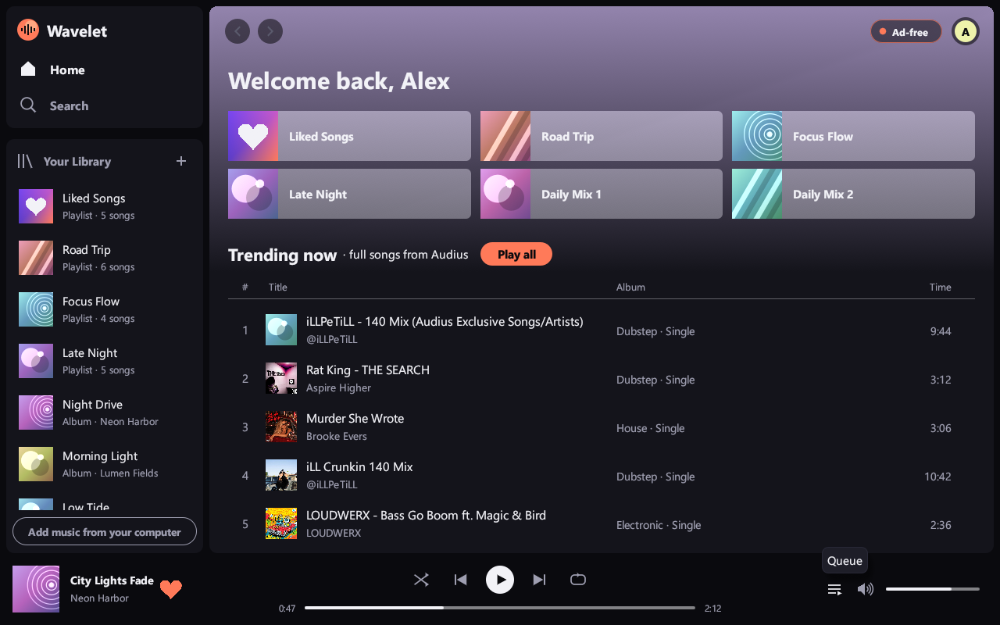
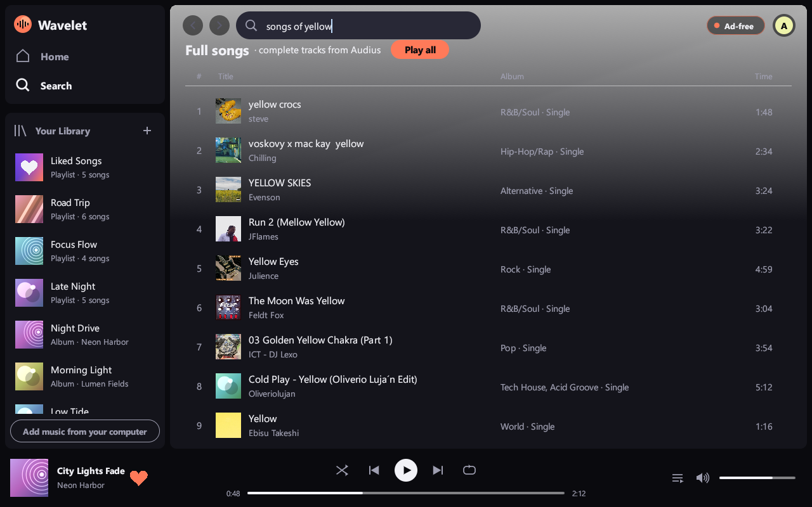
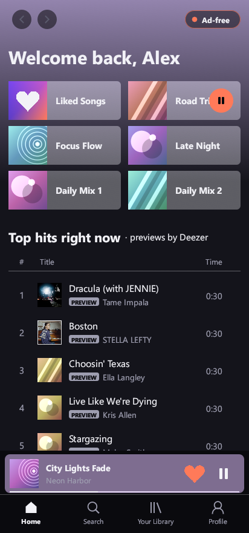
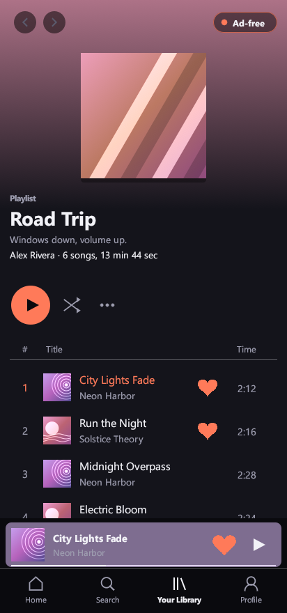
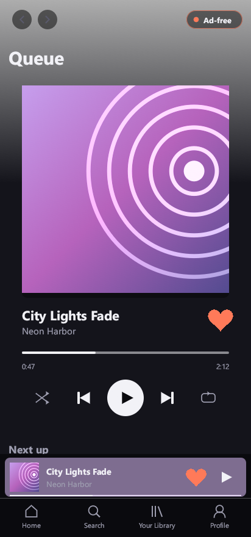

<p align="center"></p>

# Wavelet

Wavelet is an ad-free music player built with Rust and egui. It runs on Windows and Android.

## Download for Android

**[⬇ Download Wavelet.apk (version 0.6.1)](https://github.com/itsupportgoc-alt/wavelet/raw/main/app/dist/Wavelet.apk)**

New in 0.6.1: songs play their **whole length** instead of stopping at 30 seconds. The computer app fetches every chart song in full. On the phone, whole versions are looked up as soon as a song list appears and are shown in the list itself, with a 30-second preview only where no whole version exists. The version you have is shown at the bottom of the Profile page.

How to install:

1. Open the link above on your Android phone and download `Wavelet.apk`.
2. Open the downloaded file. If the phone asks, allow your browser or Files app to **install unknown apps**.
3. Tap **Install**, then open **Wavelet**.

Works on Android 8.0 or newer, on 64-bit phones (most phones from 2017 onward).

## Screenshots

### Windows

<p align="center">
  
  
</p>

### Android

<p align="center">
  
  
  
</p>

## Features

- Search a song catalogue and play every song in full (the whole track, not a 30-second preview), plus full-length songs from Audius
- Liked songs, playlists, queue, shuffle and repeat
- Play music files from your own computer or phone

## Build it yourself

```
cd app; cargo run               # desktop app (Windows)
.\build-android.ps1       # Android app -> app\dist\Wavelet.apk
```
