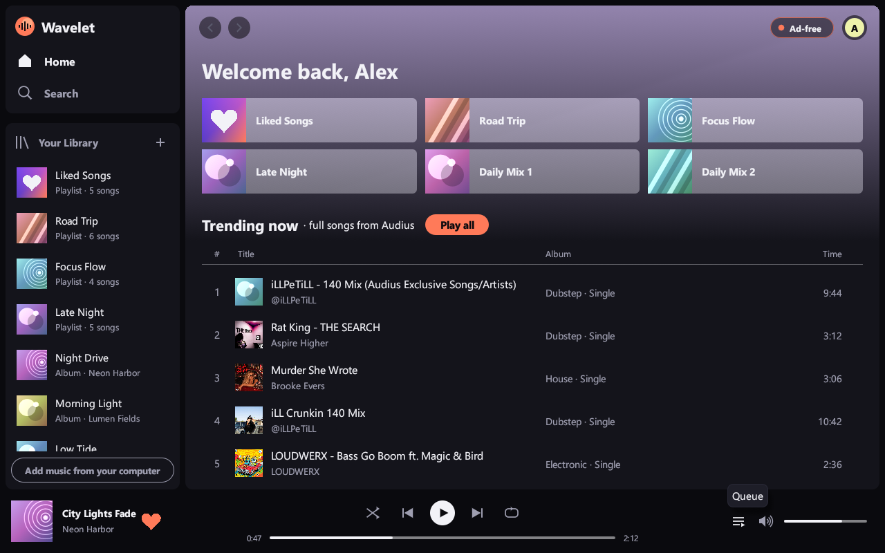
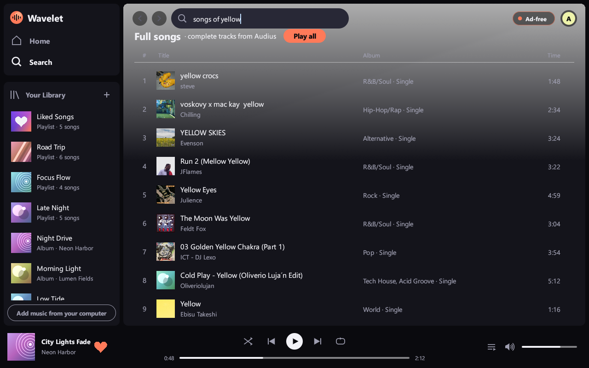
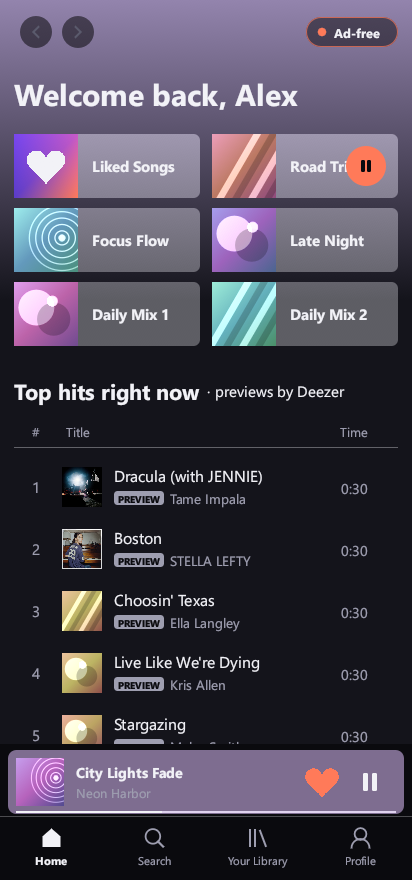
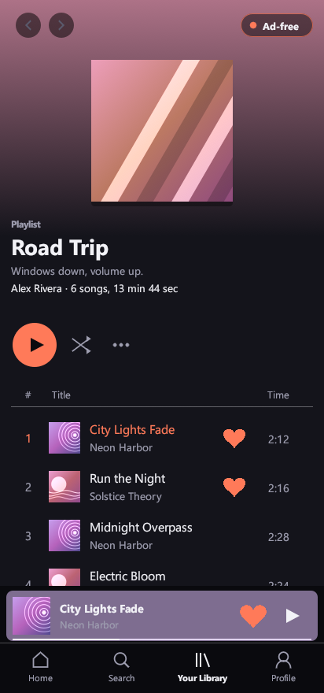
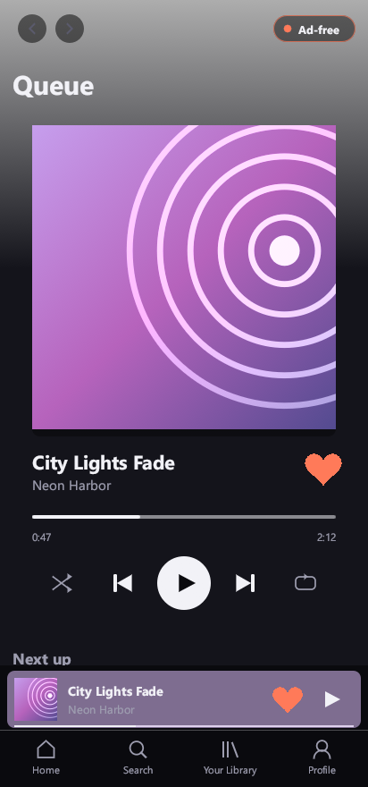

<p align="center"></p>

# Wavelet

Wavelet is an ad-free music player built with Rust and egui. It runs on Windows and Android.

## Download for Windows

**[Download Wavelet.exe for Windows (version 0.9.0)](https://github.com/itsupportgoc-alt/wavelet/raw/main/app/dist/Wavelet.exe)**

How to install:

1. Open the link above on your computer and download `Wavelet.exe` into a folder you keep, such as your Documents folder.
2. Double-click `Wavelet.exe`. Windows may warn that the publisher is unknown, because the file is not signed: choose **More info**, then **Run anyway**.
3. Right-click the file and pick **Send to > Desktop (create shortcut)** so Wavelet is one click away.

Works on Windows 10 and 11, 64-bit. Nothing else needs installing: the app keeps your songs and settings in your own user folder.

## Download for Android

**[⬇ Download Wavelet.apk (version 0.9.0)](https://github.com/itsupportgoc-alt/wavelet/raw/main/app/dist/Wavelet.apk)**

New in 0.9.0: a song starts in seconds instead of taking a minute — the app now fetches each song over several connections at once, because the music service throttles a single one. The top-hits list still leads with the biggest artists and every song plays its whole length.

How to install:

1. Open the link above on your Android phone and download `Wavelet.apk`.
2. Open the downloaded file. If the phone asks, allow your browser or Files app to **install unknown apps**.
3. Tap **Install**, then open **Wavelet**.

Works on Android 8.0 or newer, on 64-bit phones (most phones from 2017 onward).

## Screenshots

### Windows

<p align="center">
  
  
</p>

### Android

<p align="center">
  
  
  
</p>

## Features

- Search a song catalogue and play every song in full (the whole track, not a 30-second preview) — on the computer and on your phone
- Liked songs, playlists, queue, shuffle and repeat
- Play music files from your own computer or phone

## Build it yourself

```
cargo run                 # desktop app (Windows)
.\build-android.ps1       # Android app -> dist\Wavelet.apk
```
